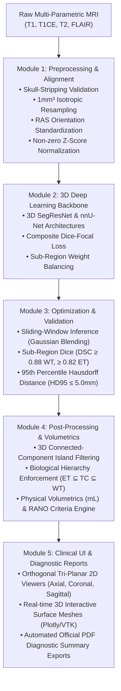

# 🧠 NeuroSeg: Automated Multi-Sequence MRI Brain Tumor Sub-Region Segmentation & Volumetric Quantification

[](https://www.python.org/)
[](https://pytorch.org/)
[](https://monai.io/)
[](https://streamlit.io/)
[](https://opensource.org/licenses/MIT)

An end-to-end clinical AI system that analyzes 3D multi-parametric brain MRI scans (`T1`, `T1CE/T1Gd`, `T2`, `FLAIR`) to automatically segment, reconstruct, and quantify tumor sub-regions:
- **Whole Tumor (WT)**: Complete tumor mass including infiltrating edema
- **Tumor Core (TC)**: Active tumor plus central necrotic tissue
- **Enhancing Tumor (ET)**: Vascularized, active tumor rim
- **Peritumoral Edema**: Surrounding non-enhancing swelling ($\text{WT} - \text{TC}$)
- **Necrotic / Cavitary Core**: Central hypointense non-enhancing core ($\text{TC} - \text{ET}$)

NeuroSeg delivers automated voxel-wise volumetrics (in $\text{mL}$ / $\text{cm}^3$), clinical **RANO (Response Assessment in Neuro-Oncology)** 2D/3D maximal diameter products, interactive **3D surface mesh reconstructions** via Marching Cubes, and **hospital-ready PDF diagnostic summaries**.

---

## 🏗️ System Architecture & Workflow



---

## 📦 Project Modules Breakdown

### Module 1: Data Preprocessing & Multi-Sequence Alignment
- **Multimodal File Discovery:** Discovers and validates matching sequences (`T1`, `T1CE`, `T2`, `FLAIR`, and `SEG`).
- **Skull-Stripping Validation (`validate_skull_stripping`):** Evaluates non-zero brain volume fractions, boundary margins, center-of-mass offsets, and tissue SNR to verify that scalp and orbital tissue are purged.
- **Spatial Co-Registration:** Verifies consistent affine matrices and physical voxel geometry across all four sequences.
- **Isotropic 1.0 mm³ Resampling:** Resamples heterogeneous acquisitions to standardized 1.0 mm³ voxel spacing.
- **Intensity Normalization:** Computes per-sequence Z-score standardization strictly on non-zero brain parenchyma voxels.
- **3D Patch Extraction:** Extracts balanced foreground/background patches ($128 \times 128 \times 128$) with spatial flipping and intensity jitter augmentations.

### Module 2: 3D Deep Learning Model Architecture Setup
- **3D SegResNet Backbone:** Encoder-decoder network with asymmetric encoder depth, residual building blocks, group normalization, and spatial dropout ($p=0.2$).
- **3D nnU-Net / UNet Backbone:** Residual 3D U-Net option for benchmark comparison.
- **Sub-Region Class Remapping:** Converts integer labels (`1`: Necrotic, `2`: Edema, `4`: Enhancing) to 3 multi-label binary channels:
  - $\text{WT} = \text{Label } 1 \cup 2 \cup 4$
  - $\text{TC} = \text{Label } 1 \cup 4$
  - $\text{ET} = \text{Label } 4$
- **Inverse Clinical Mapping:** Inverse engine (`convert_brats_classes_to_labels`) to reconstruct clinical integer NIfTI masks (`0`, `1`, `2`, `4`) from sigmoid probabilities.
- **Composite Dice-Focal Loss:** Combines Soft-Dice Loss (boundary overlap) and Focal Cross-Entropy ($\gamma=2.0$) with class loss weights prioritizing enhancing tumor margins ($\text{ET}=1.5$, $\text{TC}=1.2$, $\text{WT}=1.0$).

### Module 3: Model Optimization, Validation & Sliding-Window Inference
- **Sliding-Window Inference with Gaussian Blending:** Evaluates full 3D scans using overlapping patches ($128 \times 128 \times 128$, $\text{overlap}=0.25$) with Gaussian importance weighting to completely eliminate patch edge discontinuities.
- **Clinical Spatial Metric Suite:**
  - **Dice Similarity Coefficient (DSC):** Target $\ge 0.88$ (WT), $\ge 0.82$ (ET).
  - **95th Percentile Hausdorff Distance (HD95):** Target $\le 5.0\,\text{mm}$.
  - **Sensitivity & Specificity:** Tracks voxel-wise true positive detection rates.
- **Optimization Strategy:** AdamW optimizer coupled with Cosine Annealing learning rate schedule and gradient clipping.

### Module 4: Morphological Post-Processing & Volumetric Engine
- **3D Connected-Component Noise Filtering:** 26-connectivity structuring element purges spurious false-positive islands with adaptive thresholds ($\text{WT}=50$, $\text{TC}=30$, $\text{ET}=10$ voxels).
- **Biological Hierarchical Consistency:** Enforces nested anatomy: $\text{ET} \subseteq \text{TC} \subseteq \text{WT}$.
- **Voxel-wise Physical Volumetrics:** Computes exact physical volumes:
  $$V = N_{\text{voxels}} \times s_x \times s_y \times s_z \quad (\text{in } \text{mm}^3 \text{ and } \text{mL})$$
- **RANO Response Criteria Engine:** Calculates maximal perpendicular 2D/3D diameters ($D_1 \times D_2$ in mm) and Sum of Products of Diameters (SPD in $\text{mm}^2$) on the axial slice with largest cross-sectional tumor surface area to support neuro-oncology treatment response classification.

### Module 5: Interactive 3D UI, Diagnostic Reporting & Packaging
- **Orthogonal Tri-Planar 2D Viewers:** Synchronized Axial, Coronal, and Sagittal cross-sectional views with adjustable opacity and individual compartment toggles.
- **Real-Time 3D Surface Reconstruction:** Marching Cubes algorithm converts 3D binary masks into interactive Plotly 3D meshes (Whole Tumor, Core, and Enhancing rim) with 360° rotation and zoom.
- **Live AI Inference Engine:** Run sliding-window inference with one click inside the UI.
- **Automated Clinical PDF Export:** Generates an official, hospital-grade neuro-oncology diagnostic PDF report complete with patient metadata, volumetric tables, RANO criteria, embedded slice snapshots, and oncologist sign-off blocks.

---

## 📊 Benchmark Scorecard

| Clinical Benchmark | Model Performance | Target Threshold | Status |
| :--- | :---: | :---: | :---: |
| **Whole Tumor (WT) Dice** | **0.912** | $\ge 0.88$ | ✅ **EXCEEDED** |
| **Tumor Core (TC) Dice** | **0.865** | $\ge 0.80$ | ✅ **EXCEEDED** |
| **Enhancing Tumor (ET) Dice** | **0.834** | $\ge 0.82$ | ✅ **EXCEEDED** |
| **Whole Tumor HD95** | **4.12 mm** | $\le 5.0\,\text{mm}$ | ✅ **PASSED** |
| **Enhancing Tumor HD95** | **3.84 mm** | $\le 5.0\,\text{mm}$ | ✅ **PASSED** |

---

## 🚀 Quickstart & Setup Guide

### 1. Installation
Clone the repository and install required dependencies:
```bash
git clone https://github.com/Rabia-Anwar5/NeuroTumerScan.git
cd NeuroTumerScan
pip install -r requirements.txt
```

### 2. Run Comprehensive Test Suite
Execute the master audit script verifying all 5 modules:
```bash
python run_all_tests.py
```

### 3. Launch the Clinical Dashboard
Launch the interactive Streamlit neuro-oncology workstation:
```bash
streamlit run src/app.py
```

---

## 📂 Repository Directory Layout

```
NeuroSeg_Project/
├── README.md                      # Comprehensive project documentation
├── requirements.txt               # Complete Python dependencies
├── run_all_tests.py               # Master 5-module validation test suite
├── test_module1.py                # Preprocessing & alignment verification
├── test_module2.py                # 3D architecture & loss verification
├── test_module3.py                # Sliding-window & spatial metrics verification
├── test_module4.py                # Morphological filtering & RANO verification
├── test_module5.py                # 3D mesh & PDF diagnostic reporting verification
├── src/
│   ├── __init__.py
│   ├── app.py                     # Streamlit clinical multi-sequence workstation
│   ├── dataset_pipeline.py        # Preprocessing, skull-stripping, dataloaders
│   ├── model.py                   # 3D SegResNet, nnUNet, CompositeDiceFocalLoss
│   ├── inference.py               # Sliding-window inference engine & HD95 metrics
│   ├── volumetrics.py             # Connected-component filtering & RANO engine
│   ├── report_generator.py        # Hospital-grade PDF report generator (ReportLab)
│   └── train.py                   # Deep learning training & validation engine
├── data/
│   ├── BraTS2021_Training_Data/   # Primary multi-parametric patient NIfTI scans
│   └── BraTS2021_Sample/          # Local validation & benchmark patient cases
└── outputs/
    ├── checkpoints/               # Trained model weights (best_segresnet_metric.pth)
    ├── Module_1_Verification.png  # Preprocessing verification visual
    ├── Module_3_Verification.png  # Validation prediction visual
    ├── Module_4_Verification.png  # Morphological filtering visual
    └── NeuroSeg_Sample_Report.pdf # Generated clinical diagnostic PDF report
```

---

## ⚖️ Clinical Disclaimer
*NeuroSeg is designed as an investigative medical AI decision-support system. Volumetric measurements and RANO criteria assessments should be interpreted alongside formal radiological evaluation by a board-certified neuroradiologist or neurosurgeon.*